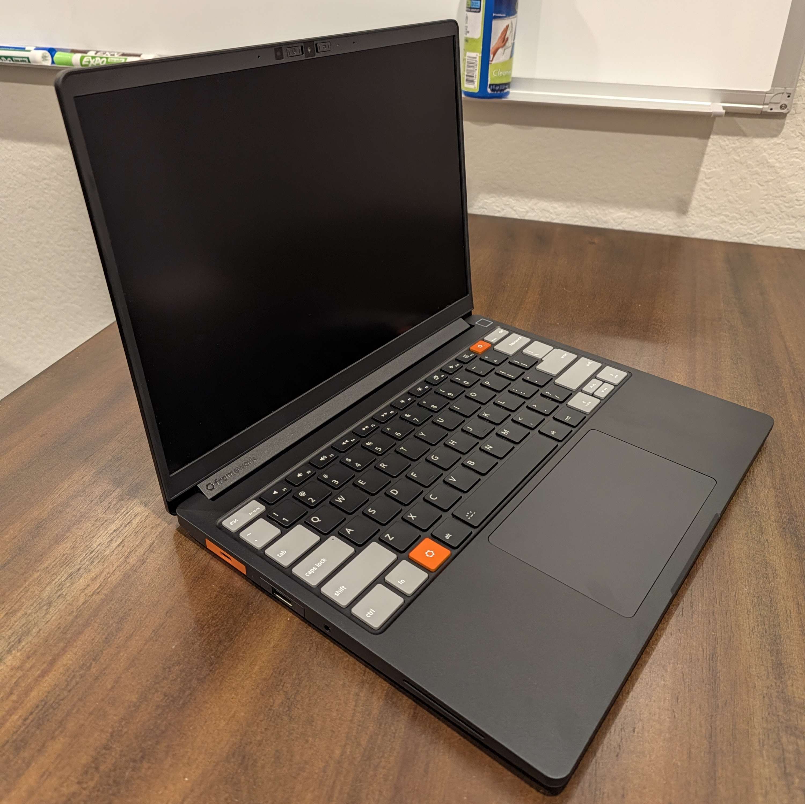
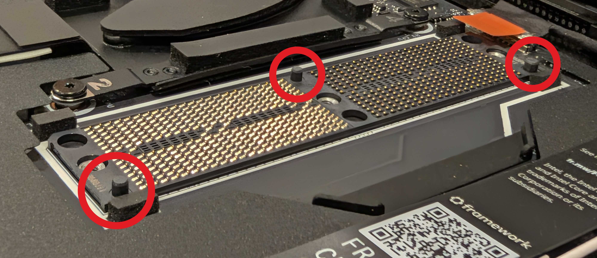
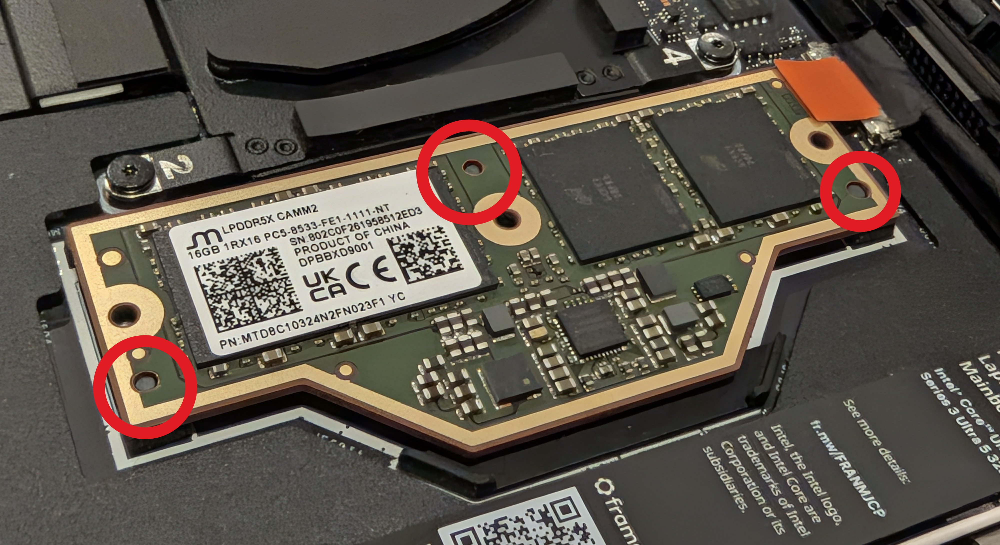
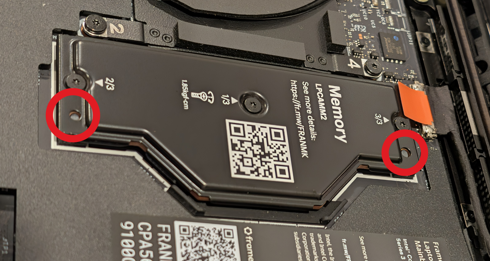

At long last, my Framework 13 Pro arrived! I must say, I'm delighted with it so
far. I hope to make this the first post in a series about this laptop as I put
it through its paces, so let me know what you would like to know about the
laptop in the comments!

## Configuration

Earlier this year, I preordered the Framework 13 Pro DIY Edition. The preorder
process for Framework uses a batch system where they send out the laptops in
batches based on when you ordered the device instead of all at once. I was in
Batch 12 which was supposed to ship in September. However, due to a glitch in
the touchpad drivers, they delayed shipping on all models by a month.

This was the order that got delivered:

| Item                                                                    |                Price |
| ----------------------------------------------------------------------- | -------------------: |
| Framework Laptop 13 Pro DIY Edition (Intel® Core™ Ultra 5 325 Series 3) |              $981.00 |
| 16 GB LPCAMM2 LPDDR5 RAM [^1]                                           |              $339.00 |
| Black Bezel                                                             |               $39.00 |
| Gray/Black Input Cover Kit                                              |              $189.00 |
| USB-C Expansion Card (x3, two Orange, one Graphite)                     | 3 @ \$10.00 = $30.00 |
| USB-A Expansion Card (Graphite)                                         |               $10.00 |
| HDMI Expansion Card (Graphite)                                          |               $22.00 |
| Ethernet Expansion Card                                                 |               $39.00 |
| **Subtotal**                                                            |            $1,549.00 |
| **Tax**                                                                 |               $77.50 |
| **Total**                                                               |        **$1,626.50** |

[^1]: I ordered 32 GB of LPCAMM2 RAM in my original preorder. However,
    [due to the RAM shortage](https://frame.work/blog/updates-on-memory-pricing-and-navigating-the-volatile-memory-market),
    I was downgraded to 16 GB in June (they did reduce the price down to the 16
    GB price point). I had an option to upgrade back up to 32 GB at the new
    pricing, but I decided to just stay with 16 GB since I don't really do much
    on my personal laptop that requires a lot of memory. I'll definitely be
    monitoring this to see if I made the right decision.

I pulled the M.2 drive from my ThinkPad T14s[^2] so I didn't order an SSD. I
also did not order a power adapter since I have enough random ones lying around
the house.

I think that this is a pretty decent deal, considering the RAM apocalypse. I
spot checked some alternative machines such as the 14" MacBook Pro and the
latest ThinkPad T14s, and they were in the same range as a Framework 13 Pro with
all parts included. Since I was able to skip buying a few expensive components,
the Framework was definitely worth it for me.

[^2]: My ThinkPad motherboard blew up (literally shorted itself) a few months
    ago, so I pulled out the SSD to salvage it.

## Shipping

I received the batch preparation email on 8 October indicating that payment
would be taken for my laptop on 12 October. The payment was actually taken on 11
October. Obviously that was fine by me, but I think that this may cause others
issues if they have their cards locked by default or something like that.

On 15 October, I received an email saying that my order had shipped with a FedEx
tracking number. The order was in the FedEx system that morning, and on Friday,
16 October it was shipped to Oakland, California via Sennan, Japan.

The package was held in a clearance delay all weekend and was finally released
on 19 October (Monday) in afternoon. My understanding of clearance delays is
that they are caused by incorrect paperwork, so I'm not sure what got messed up,
but I'm not very happy about it. I'm also unhappy that it took another two days
for FedEx to deliver my package with it arriving on 21 October (Wednesday).

Overall, the shipping was a lot slower than for many people that I've seen on
the internet. Many of them are getting their shipments delivered the day after
it leaves Taiwan.

Regardless, it finally arrived and the box was in good condition.

## Installation Process

If you want to know what the unboxing experience is like, there are plenty of
unboxing videos out there that will do a better job than I will in a blog post.
However, I feel like a lot of the unboxings gloss over some of the details of
the DIY installation process.

Specifically, I was curious about the LPCAMM RAM installation process. What I
discovered was that there are three small "pegs" that go through the interposer
and LPCAAM chip, and two which go all the way up to the memory cover.

I've installed both desktop and laptop RAM before, but never in this form
factor, so it was fun to learn how to do it. It was a lot more foolproof than I
thought it would be.

## Build Quality

I was also curious about the build quality of the machine. The Framework
marketing is that the device is meant to be the "MacBook Pro for Linux users".
But in my opinion, there is already a laptop line with that title: ThinkPad. In
order to become the default laptop for Linux users, Framework needs to compete
with ThinkPad as much as they need to compete with MacBooks.

Both the MacBook and ThinkPad lines set a pretty high bar for build quality, so
I was curious to see how Framework would stack up. I have a few friends with the
original Framework 13 and it felt like the quality was decent on them, but not
quite the level of a MacBook or ThinkPad.

Here are my thoughts on a few things that I care about regarding build quality
and how they compare to MacBooks and ThinkPads.

- **Chassis Rigidity.** The aluminum chassis feels very MacBook-ish. It's not
  soft touch like the ThinkPad. I think that metal vs soft touch is a personal
  preference. I like metal, personally, and so the Framework 13 Pro is perfect
  for me.

  I was worried about how the input cover and body would mate and whether it
  would feel unified. I'm happy to say that it fits very nicely. The tolerances
  are tight and there is no perceivable lip or anything like that.

  A lot of the reviews also talk about the lack of flex in the chassis. I can
  report that it has no flex under normal amounts of force. (If you apply
  JerryRigEverything kind of force to the chassis, I'm sure you could get it to
  bend.)

  None of the reviews I've seen talk about the flex of the screen, however. The
  screen does flex a bit, but not much. The Framework 13 Pro screen definitely
  has more flex than my work Dell XPS which has quite a thick screen backing and
  virtually no flex. It also has more flex than my ThinkPad T14s. Unless you are
  manhandling your screen regularly, the screen is plenty sturdy.

  A lot of reviews talk about the hinge being wobbly, and I think that is
  overblown. Maybe if you use the touchscreen a lot more you'd notice, but in
  normal use, the screen does not wobble at all.

- **Keyboard.** I think the keyboard feels slightly mushy compared to my
  ThinkPad. The key travel is great, but it doesn't have quite as much
  resistance as I would like at the top end of the keypress. That being said,
  it's a good keyboard, and the amount of travel alone makes it much better than
  the modern MacBook keyboards.

  I ordered the grey and orange accented version of the keyboard, and that was
  definitely the correct decision. It adds some nice character to the machine.

- **Trackpad.** The trackpad is nice. It's a haptic trackpad and the click is
  satisfactory. It's better than my old physical button ThinkPad (my ThinkPad
  touchpad was getting worn out) and it seems close enough to MacBook quality
  that it works for my use cases.

  I think the biggest area for improvement is the multi-finger detection. So
  far, I've had issues getting the three-finger click to be consistently
  differentiated from two finger click. Often, when I attempt to do a
  three-finger click (middle click) but it registers as a left click (two
  fingers). I am not sure if this can be tuned or not, but this is my current
  biggest annoyance with this laptop.

- **Screen.** I'm too blind to really appreciate good screens, but this one is
  nice. I'm running Hyprland at 1.5x scaling, and it looks great.

  The screen is matte but also a touchscreen. When you touch it, it feels like
  it shouldn't be a touchscreen, but then it is. I'm not sure how much I'll
  utilise the touch functionality, but it might be nice for scrolling websites
  or something.

## Future Investigations

There are a few things which I will be investigating over the next little while:

- **Battery Life.** I want to see what the usage is with my workload. It seems
  good so far, and I haven't done any energy saving configuration yet, so we
  will see. I'm going to KubeCon in a few weeks, so I'll have a chance to really
  test the battery life there.

- **Screen in Direct Sunlight.** I've heard that the screen is pretty good in
  sunlight. I will have to try that out and see if it actually is or if that's
  just marketing.

- **Fingerprint Sensor.** I haven't set up the fingerprint scanner yet. I'll
  have to try that out and see if it's reliable enough to replace just typing my
  password.

- **Fan Noise.** I have heard the fan go once, very softly while I was compiling
  a Rust program. I'm curious to see if it really ever runs during normal use. I
  have a feeling it won't.

## Conclusion

I'm excited to use the Framework 13 Pro and put it through its paces. So far,
I'm very happy with my purchase. It's a solidly built machine, and I'm curious
to see how it feels to use over a longer period of time. I'm hoping to make a
couple follow-up posts about my experience, so stay tuned for more.
